# Criteria-Governed Decision-Making in Sparse Seismic Networks

[](LICENSE)
[](LICENSE-results.md)
[](https://doi.org/10.17605/OSF.IO/Y8QXZ)
[](https://doi.org/10.5281/zenodo.24053125)
[](requirements.txt)
[](results/v2/NETWORK_CHECK.md)

Code, pre-specified test plans, per-episode decision records and result files for the manuscript

> Zhakypbekov, S.; Bykov, A.; Abzhanova, A.; Imanbekova, T.; Lavrov, E.; Shaikemelova, A.; Mametova, R. Missing versus Non-Confirming Neighbour Evidence in Sparse Seismic Alarm Triage: A Criteria-Governed Rule Tested at Kazakhstan and Alaska Stations. Prepared for *Sensors* (MDPI), 2026.

and for a companion study of 38 seismic networks. [MANIFEST_PAPER1.md](MANIFEST_PAPER1.md) maps every table of that manuscript to its script and result file; [MANIFEST.md](MANIFEST.md) maps the earlier combined build v35 (not submitted).
Pre-specification: each plan is dated by its push time and the first data request in [results/provenance/prespecification_timeline.json](results/provenance/prespecification_timeline.json). The test plan of the 38-network study is registered on OSF: https://osf.io/y8qxz (DOI [10.17605/OSF.IO/Y8QXZ](https://doi.org/10.17605/OSF.IO/Y8QXZ)).
Archive: Zenodo, all versions DOI [10.5281/zenodo.24053124](https://doi.org/10.5281/zenodo.24053124).

## Claim

A sparse seismic network confirms a trigger at one station by checking its neighbours. A neighbour with no data and a
neighbour that recorded and did not trigger are different evidence; classic coincidence counts both as "no confirmation".
The criteria-governed rule (CG) encodes each neighbour site as YES, NO or MISSING, weights a NO by a reliability factor c,
refuses an automatic decision when the valid evidence is below a threshold δ, and sends alarms between two score thresholds
to an analyst. Tested against analyst-reviewed bulletins on 33 networks, the rule with a non-confirmation at full weight
(c = 1, the primary hypothesis) dismissed too many reviewed events and **failed** the pre-specified margin. With a
discounted non-confirmation (c = 0.5, or development-table weights CG-D) it stayed within 3 points of an abstaining SNR rule
while raising fewer automatic alerts without a reviewed event, and it kept dismissals low when neighbour data were missing.

## Key numbers

Every number is read from the result file named in the same row. Differences are percentage points of reviewed-associated
alarms dismissed, policy minus P3, with 95% cluster-bootstrap intervals (networks, then days; 2,000 draws, seed 7).
The margin is 3 points with a ratio bound of 1.5.

| Quantity | Value | Result file |
|---|---|---|
| Networks in the pooled catalogue-label test / reviewed-label test | 38 / 33 | [v2_eval_AB.json](results/v2/v2_eval_AB.json), [v2_eval_reviewed.json](results/v2_reviewed/v2_eval_reviewed.json) |
| Episodes (alarms) and reviewed-associated alarms, 33 networks | 263,303 and 4,321 | [stress.json](results/sufficiency/stress.json) |
| Primary R1: CG (c = 1) minus P3 | **3.89 [2.31, 5.73]**, ratio 2.109: not met | [v2_eval_reviewed.json](results/v2_reviewed/v2_eval_reviewed.json) |
| R2: CG-D minus P3 | 0.97 [0.44, 1.57], ratio 1.277 [1.145, 1.494]: met | same |
| R3: CG with c = 0.5 minus P3 | 0.74 [0.25, 1.32], ratio 1.211 [1.082, 1.392]: met | same |
| Automatic alerts without a reviewed event (33 networks) | CG 8,076; P3 23,045; tuned coincidence P1t 126,624 | same (V6) |
| Outage days of the nearest site (11 networks, 195 reviewed-associated alarms) | dismissed: CG 8, classic coincidence P1 30 | same (R7) |
| Catalogue labels, 38 networks: CG / CG-D / c = 0.5 minus P3 | 9.02 [3.86, 13.69] not met / 2.14 [0.86, 3.28] not met / 1.72 [0.65, 2.71] met | [v2_eval_AB.json](results/v2/v2_eval_AB.json) |
| Half of neighbour states removed at random (post hoc, 50 seeds): P1 minus CG c = 0.5 | 28.17 [24.13, 32.46] | [stress.json](results/sufficiency/stress.json) |
| Same test, dismissals prevented by δ = 0.45 | 0.37 [0.08, 0.88] | same |
| Real episodes with ≥ 2 neighbour sites missing (3,062) | P1 dismissed 9 of 35 reviewed-associated, every CG variant 0 | [thin_subset.json](results/sufficiency/thin_subset.json) |
| Alaska, analyst-confirmed events (3,943): CG minus P3, G1 | 3.75 [3.14, 4.41]: not met; CG-D 0.28 [0.10, 0.46]: met | [ground_truth_eval.json](results/ground_truth/ground_truth_eval.json) |
| Alaska, analyst-deleted events (114) raised as automatic alerts | CG 9.65%, P3 67.54%, P1t 98.25% | same |
| LLM triage baseline on the Alaska sample (600 episodes): confirmed dismissed / deleted alerted | LLM 8.85% / 65.79%; CG 3.29% / 9.65% | [llm_eval.json](results/baselines_ml_llm/llm_eval.json) |
| Decision time per episode, one CPU thread | CG median 1.1 µs; learned models 698–751 µs | [latency.json](results/baselines_ml_llm/latency.json) |

The comparison that matters most for the claim is in row 3: the rule as first specified failed. The discounted variants
are secondary hypotheses of the same plan. A two-threshold abstaining SNR rule chosen on training networks reaches the same
dismissals (experiment 27), so most of the reduction in alerts comes from the reject band, not from c.

## Pipeline

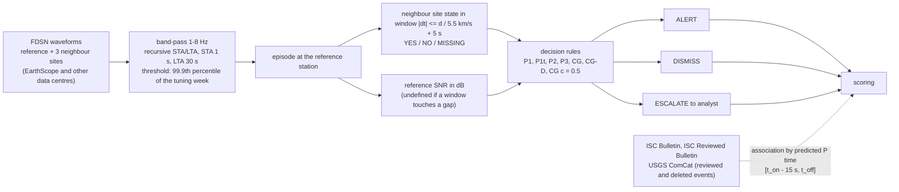

Code: `pipeline/extended_stalta_criteria.py` (detection, states, SNR, association), `analysis/v2_networks.py` (rules and
scoring of the multi-network test), `analysis/v2_reviewed_bulletin.py` (reviewed labels).

## Model

Each episode x is scored on four criteria: confirmation by three neighbour sites (nearest first) and the reference SNR.
Criterion i has a weight wᵢ, a partial score sᵢ(x) and a data-quality factor qᵢ(x).

```
D(x) = Σ wᵢ sᵢ(x) qᵢ(x) / Σ wᵢ qᵢ(x)    if Σ wᵢ qᵢ(x) ≥ δ,   otherwise no decision
neighbour site j:  s = 1 if YES, 0 otherwise;   q = 1 if YES, c if NO (recorded, no trigger), 0 if MISSING
SNR:               s = min(1, SNR / 30 dB),     q = 1 if SNR is defined, 0 otherwise
weights 0.25 / 0.20 / 0.15 (site rank 1 to 3), 0.40 (SNR);  δ = 0.45,  θ_A = 0.60,  θ_D = 0.16
```

CG uses c = 1; CG c = 0.5 uses one constant; CG-D sets c to the development confirmation rate of the neighbour in the
reference-SNR bin ([detectability_tables_dev.json](results/prereg/detectability_tables_dev.json)). Constants:
`analysis/v2_networks.py` lines 21–22, `analysis/extended_eval.py` line 18, `analysis/criteria_governed_model.py`.

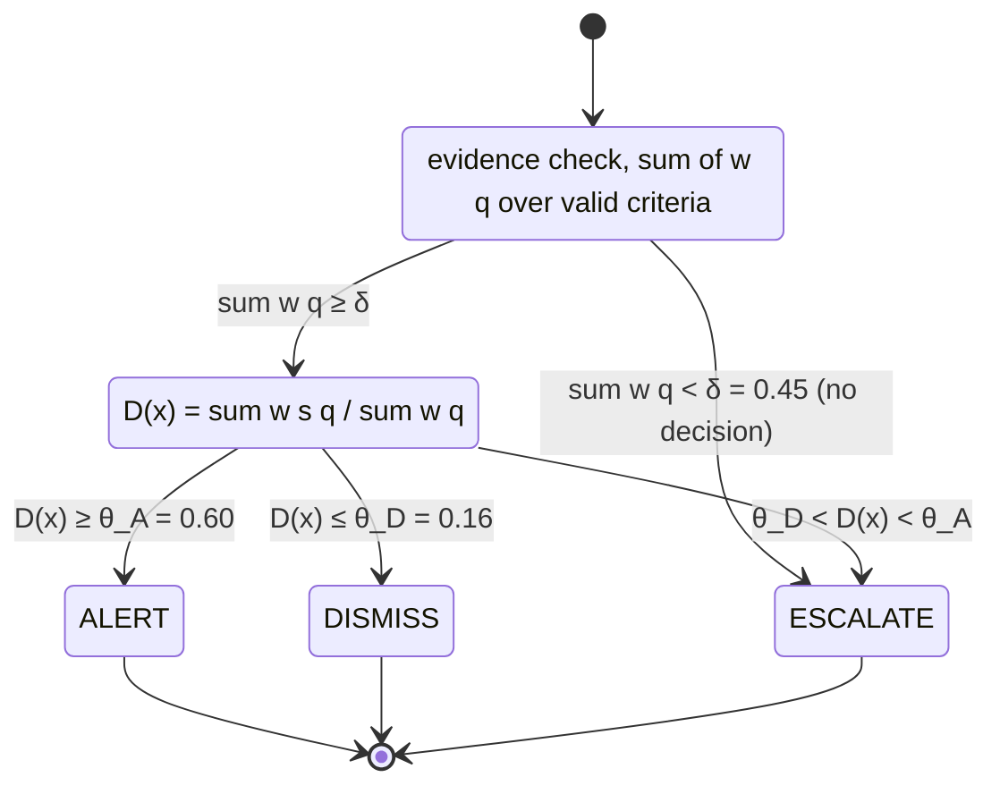

Because δ = 0.45 is larger than the SNR weight 0.40, an episode without any valid neighbour record is never decided
automatically. Lowering c can turn a dismissal into an escalation or an alert; it cannot create a dismissal.

### Records used by the code

The code works on CSV and JSON records, not on Python classes. The diagram shows the fields that the scorers read.

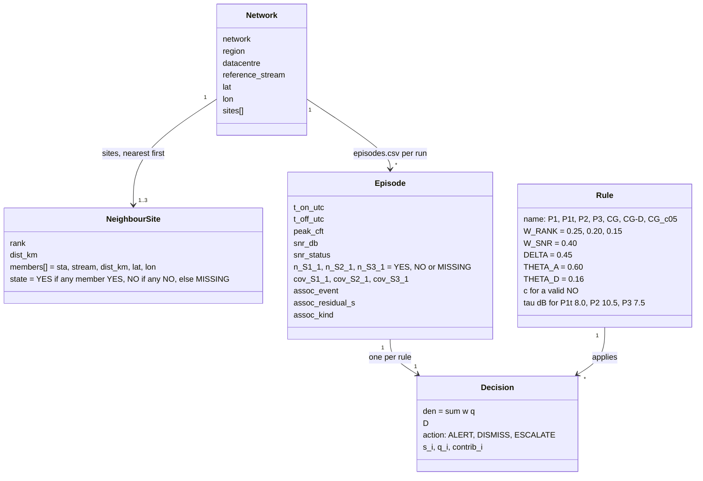

Sources: `results/v2/networks*.json` (Network, NeighbourSite), `results/v2/runs*/<NET>/out_*/episodes.csv` (Episode),
`analysis/v2_networks.py` (`merge_sites`, `policies`), `results/criteria_governed/dm_ledger_*.csv` (Decision ledger of the
single-network model).

### Evaluation flow

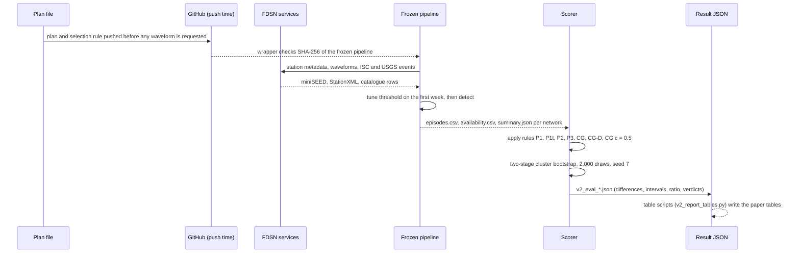

## Experiments

Pre-specified = plan pushed before the data or labels it scores. Post hoc = plan pushed after an earlier result but before
this one was computed. Push times are in [prespecification_timeline.json](results/provenance/prespecification_timeline.json).

| # | Experiment | Status | Question | Verdict | Key numbers | Plan | Result file |
|---|---|---|---|---|---|---|---|
| 1 | [Single-network tests (Kazakhstan, Alaska)](#01) | pre-specified | Is CG non-inferior to P3 at one reference station? | CG fails in Kazakhstan, met in Alaska; discounted variants met where tested | E3 2.44, N3 3.78, N5 0.84, R3 1.47 | [EXTENDED](PREREGISTRATION_EXTENDED.md), [KURK](PREREGISTRATION_KURK_EXTENDED.md), [KZ](PREREGISTRATION_KZ_NETWORK.md), [AK](PREREGISTRATION_AK_NETWORK.md) | [kz_eval.json](results/kz/kz_eval.json), [ak_eval.json](results/ak/ak_eval.json), [extended_eval.json](results/extended/extended_eval.json), [kurk_ext_eval.json](results/kurk_ext/kurk_ext_eval.json) |
| 2 | [Multi-network test, catalogue labels](#02) | pre-specified | Does rule v2 hold across networks selected by metadata? | CG fails; discounted variants met in batch B | batch B: CG 8.25, CG-D 1.89, c=0.5 1.43 | [SELECTION_RULE_V2](SELECTION_RULE_V2_2026-11-08.md), [V2_NETWORKS](PREREGISTRATION_V2_NETWORKS_2026-11-08.md), [V2_BATCHB](PREREGISTRATION_V2_BATCHB_2026-11-08.md) | [v2_eval_batchA.json](results/v2/v2_eval_batchA.json), [v2_eval_batchB.json](results/v2/v2_eval_batchB.json), [v2_eval_AB.json](results/v2/v2_eval_AB.json) |
| 3 | [Reviewed-bulletin test, 33 networks (primary)](#03) | pre-specified, OSF y8qxz | Within 3 points of P3 on analyst-reviewed events? | primary CG not met; CG-D and c = 0.5 met | CG 3.89; CG-D 0.97; c=0.5 0.74; outage CG 8 vs P1 30 | [REVIEWED_BULLETIN](PREREGISTRATION_REVIEWED_BULLETIN_38NET_2026-11-08.md) | [v2_eval_reviewed.json](results/v2_reviewed/v2_eval_reviewed.json) |
| 4 | [12-month extension (ext12B)](#04) | pre-specified | Does the result hold over a full year? | 12 of 31 networks; discounted variants met | full year: CG-D 0.77, c=0.5 0.29, CG 3.71 | [V2_EXT12_B](PREREGISTRATION_V2_EXT12_B_2026-11-08.md) | [v2_eval_ext12B.json](results/v2/v2_eval_ext12B.json), [v2_eval_B_ext12B.json](results/v2/v2_eval_B_ext12B.json) |
| 5 | [Rescue of excluded networks](#05) | pre-specified | Do the networks that first failed change the result? | primary result unchanged; rescued set alone fails the ratio criterion | rescued c=0.5 0.62 (ratio upper 2.043); primary+rescued 0.72 (1.397) | [V2_RESCUE](PREREGISTRATION_V2_RESCUE_2026-11-08.md) | [v2_eval_rescue.json](results/v2_rescue/v2_eval_rescue.json) |
| 6 | [Context-dependent reliability c_j(x)](#06) | pre-specified (recalibration post hoc) | Does a per-alarm reliability beat a constant c? | H1–H4 held; lower Brier mainly from resolution | Brier 0.176 vs 0.25; dismissed 61 vs P3 68 | [CONTEXT_C](PREREGISTRATION_CONTEXT_C_2026-11-08.md), [CONTEXT_RECAL](PLAN_CONTEXT_RECAL_2026-11-08.md) | [context_c.json](results/context_c/context_c.json), [recal.json](results/context_c/recal.json) |
| 7 | [Regions](#07) | post hoc | Does the result hold outside the USA? | c = 0.5 within the margin in every region except the single East Asia network | all 0.74; outside USA–Mexico 0.77 [0.04, 1.54] | [REGIONS](PLAN_REGIONS_2026-11-08.md) | [regions.json](results/posthoc/regions.json) |
| 8 | [Analyst workload](#08) | post hoc | Is escalation worth the analyst time? | same analyst minutes as P3, about half the false automatic alerts | 37.7 min per network-day; false alerts 3.84 vs 1.82 | [WORKLOAD](PLAN_WORKLOAD_2026-11-08.md) | [workload.json](results/posthoc/workload.json) |
| 9 | [Gap map: overlap, chance, leave-one-out](#09) | post hoc | Is c = 0.5 just P3? Does one network drive it? | no verdict changes | Jaccard 0.81; chance-corrected 0.32; LOO changes 0 | [GAP_REVIEWED](PLAN_GAP_REVIEWED_2026-11-08.md) | [gap_reviewed.json](results/gap/gap_reviewed.json) |
| 10 | [Weights and thresholds sensitivity, ablations](#10) | post hoc | Do the verdicts depend on hand-set weights? | yes | share of 675 points met: c=0.5 0.64, CG-D 0.53, CG 0.31 | [SENSITIVITY_WEIGHTS](PLAN_SENSITIVITY_WEIGHTS_2026-11-08.md) | [sens_weights.json](results/sensitivity/sens_weights.json), [ablations.json](results/sensitivity/ablations.json) |
| 11 | [Two-threshold baseline and alert cost](#11) | post hoc | Is the gain from c or from the reject band? | close to a two-threshold rule; alert reduction mainly from the reject band and θ_A | matched P3 8.0/13.5 dB: dismissed 175 vs 183; false alerts/day 1.62 vs 1.82 | [TWOTHRESHOLD](PLAN_TWOTHRESHOLD_2026-11-08.md) | [twothreshold.json](results/posthoc/twothreshold.json), [twothreshold_cost.json](results/posthoc/twothreshold_cost.json) |
| 12 | [Detection-probability likelihood baseline](#12) | post hoc | Does a likelihood-ratio rule do better? | no: more dismissals, fails the ratio criterion | LLR-M 102, LLR-T 139 vs c=0.5 81 | [DETPROB_BASELINE](PLAN_DETPROB_BASELINE_2026-11-08.md) | [detprob.json](results/detprob/detprob.json) |
| 13 | [Forward re-tuning, low-chance subset, G.WUS](#13) | post hoc | Does the failure come from the frozen threshold? | re-tuned forward in time, all three variants meet both criteria | CG 0.08, CG-D 0.11, c=0.5 0.06 | [GAP2](PLAN_GAP2_2026-11-08.md) | [forward_retune.json](results/gap2/forward_retune.json), [low_chance.json](results/gap2/low_chance.json), [wus_removed.json](results/gap2/wus_removed.json) |
| 14 | [Learned baselines with a reject band](#14) | post hoc | Do ML models with abstention do better? | fewer dismissals, more escalations and false alerts | LR 31, GB 42, MLP 69 vs c=0.5 81 | [learned_rejectband](PLAN_learned_rejectband_2026-11-08.md) | [learned_rejectband.json](results/review2/learned_rejectband.json) |
| 15 | [Calendar bootstrap; Holm at 20,000 resamples](#15) | post hoc | Do the results survive dependence and multiplicity? | c = 0.5, CG-D and context-c H1/H2 pass Holm; CG does not | c=0.5 Holm p 0.0057; CG Holm p 1.0 | [calendar_ctx](PLAN_calendar_ctx_2026-11-08.md), [holm_hires](PLAN_holm_hires_2026-11-08.md) | [calendar_ctx.json](results/review2/calendar_ctx.json), [holm_hires.json](results/review2/holm_hires.json) |
| 16 | [Margin from analyst cost](#16) | post hoc | Is 3 points lenient or strict in analyst minutes? | depends on the cost of a false alert | observed excess c=0.5 0.74, CG-D 0.97 | [margin_cost](PLAN_margin_cost_2026-11-08.md) | [margin_cost.json](results/review2/margin_cost.json) |
| 17 | [Undefined SNR; threshold-table check](#17) | post hoc | Do edge cases change anything? | no | 284 undefined-SNR episodes; 81 cells, 0 mismatches | [undefined_snr](PLAN_undefined_snr_2026-11-08.md), [threshold_table](PLAN_threshold_table_2026-11-08.md) | [undefined_snr.json](results/review2/undefined_snr.json), [threshold_table.json](results/review2/threshold_table.json) |
| 18 | [Magnitude–distance detection probability](#18) | post hoc | Does context c match a standard seismological quantity? | partly | Brier 0.156 model, 0.191 context c, 0.25 constant | [REVIEW3](PLAN_REVIEW3_2026-11-08.md) | [detprob_schorlemmer.json](results/review3/detprob_schorlemmer.json) |
| 19 | [Cost-optimal thresholds](#19) | post hoc; false-alert frames exploratory | How close are the frozen thresholds to cost-optimal? | far from optimal | F = 15: c=0.5 54.7, CG-D 52.1, P3 86.2, P1t 269.0 | [REVIEW3](PLAN_REVIEW3_2026-11-08.md) | [costopt_thresholds.json](results/review3/costopt_thresholds.json), [costopt_falsealert_F15.json](results/review3/costopt_falsealert_F15.json) |
| 20 | [Learned false-event screen](#20) | post hoc | Does a learned screen beat the rule? | matches P3 only by escalating and alerting more | false alerts 14,885 vs c=0.5 6,842 | [REVIEW3](PLAN_REVIEW3_2026-11-08.md) | [draelos_screen.json](results/review3/draelos_screen.json) |
| 21 | [Kazakhstan, analyst-reviewed labels](#21) | pre-specified | Do the Kazakhstan results hold on reviewed events? | MAKZ all met; KZ CG not met; KURK L2 c = 0.5 not met | MAKZ CG 1.27; KZ CG 3.10; KURK L2 c=0.5 3.10 | [KZ_ANALYST_LABELS](PREREGISTRATION_KZ_ANALYST_LABELS_2026-11-08.md) | [kz_reviewed_eval.json](results/kz_analyst/kz_reviewed_eval.json) |
| 22 | [Blind adjudication package](#22) | prepared, not done | Would an analyst confirm the disputed dismissals? | no result | 102 cases, no rule labels | — | [adjudication/blind_v1/](adjudication/blind_v1/) |
| 23 | [Evidence-sufficiency stress test](#23) | post hoc | What happens when neighbour evidence is lost? | S1–S3 held | S1 28.17 [24.13, 32.46]; S2 0.37 [0.08, 0.88]; S3 −3.78 | [SUFFICIENCY_STRESS](PLAN_SUFFICIENCY_STRESS_2026-11-08.md) | [stress.json](results/sufficiency/stress.json), [thin_subset.json](results/sufficiency/thin_subset.json) |
| 24 | [Alaska analyst ground truth](#24) | pre-specified | Does CG keep confirmed events and stop deleted ones? | G1 not met; G2–G4 held | G1 3.75; deleted alerted CG 9.65%, P3 67.54% | [GROUND_TRUTH](PREREGISTRATION_GROUND_TRUTH_2026-11-08.md) | [ground_truth_eval.json](results/ground_truth/ground_truth_eval.json) |
| 25 | [ML and LLM baselines, latency](#25) | pre-specified (budget variant post hoc) | Do learned models or an LLM triage alarms better? | none better on all counts | confirmed dismissed CG 3.29% vs LLM 8.85%; CG 1.1 µs | [BASELINES_ML_LLM](PREREGISTRATION_BASELINES_ML_LLM_2026-11-08.md) | [llm_eval.json](results/baselines_ml_llm/llm_eval.json), [ml_eval.json](results/baselines_ml_llm/ml_eval.json), [latency.json](results/baselines_ml_llm/latency.json) |
| 26 | [Explosion-associated alarms](#26) | pre-specified, not exercised | What do the policies do with explosions? | descriptive only | IU.MAKZ, 308 mining explosions: CG alert 29.22%, P1t 98.38% | [EXPLOSIONS](PREREGISTRATION_EXPLOSIONS_2026-11-08.md) | [explosions_eval.json](results/explosions/explosions_eval.json) |
| 27 | [Training-chosen two-threshold rule, δ sweep](#27) | post hoc | Is c = 0.5 different from a tuned two-threshold rule? | same dismissals; c = 0.5 alerts more, escalates less | −0.03 [−0.39, 0.26]; 81 vs 82 | [REVIEW4](PLAN_REVIEW4_2026-11-08.md) | [dev_two_threshold.json](results/review4/dev_two_threshold.json), [delta_sweep.json](results/review4/delta_sweep.json) |
| 28 | [Time-disjoint test, June–August 2023](#28) | registered, not run | Do the frozen rules hold on untouched data? | no result yet | — | [TIME_DISJOINT_2023](PLAN_TIME_DISJOINT_2023_2026-11-08.md) | — |

Each animation below is drawn from the result files by [analysis/make_readme_gifs.py](analysis/make_readme_gifs.py).

<a id="01"></a>
### 1. Single-network tests (Kazakhstan, Alaska)

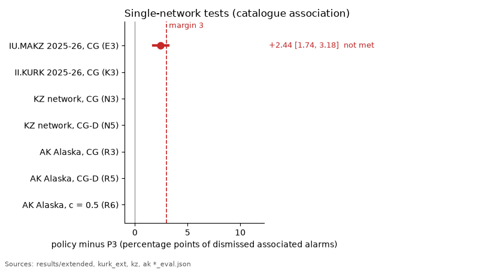

One reference station and three neighbours, catalogue association. With c = 1 the margin was not met in Kazakhstan
(IU.MAKZ E3 2.44 [1.74, 3.18], II.KURK K3, KZ network N3 3.78 [2.98, 4.69]) and was met in Alaska (R3 1.47 [1.01, 2.02]);
the discounted variants met it in both networks (KZ N5 0.84, AK R5 0.10, R6 0.15).

<a id="02"></a>
### 2. Multi-network test, catalogue labels

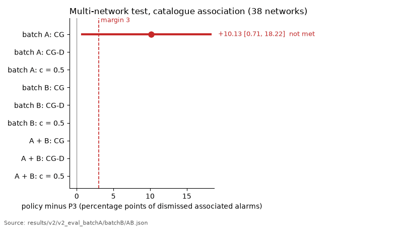

Networks chosen from FDSN station metadata by a rule pushed before any waveform was requested. CG failed in every batch
(batch B 8.25). In batch B CG-D (1.89) and c = 0.5 (1.43) met the margin; in batch A both failed, so the pooled CG-D (2.14)
did not meet it and c = 0.5 (1.72) did.

<a id="03"></a>
### 3. Reviewed-bulletin test, 33 networks (primary)

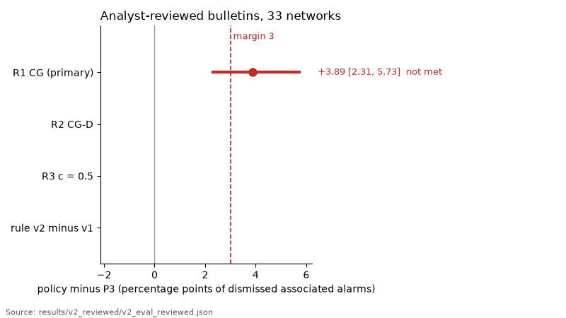

The same alarms scored against analyst-reviewed bulletins (ISC Reviewed Bulletin, ComCat reviewed events). Primary R1
(c = 1) was not met, 3.89 [2.31, 5.73]; R2 CG-D 0.97 [0.44, 1.57] and R3 c = 0.5 0.74 [0.25, 1.32] met both criteria. On
outage days of the nearest site CG dismissed 8 reviewed-associated alarms against 30 for P1. Registered on OSF.

<a id="04"></a>
### 4. 12-month extension (ext12B)

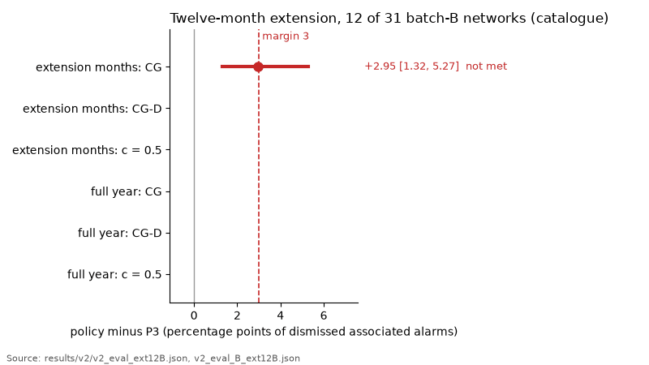

Batch-B networks extended to twelve months; 12 of 31 networks completed before the cutoff logged in
[FLEET_DEVIATIONS.md](results/v2/FLEET_DEVIATIONS.md) (2026-11-08 08:30 UTC), and the run was scored at that point. Over the
full year CG-D (0.77) and c = 0.5 (0.29) met the margin; CG (3.71) did not.

<a id="05"></a>
### 5. Rescue of excluded networks

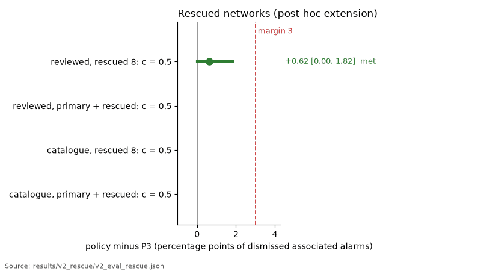

Eight networks that failed the first run were re-processed under a fixed rescue rule. Adding them keeps c = 0.5 within both
criteria on reviewed labels (0.72, ratio bound 1.397); the rescued set alone meets the difference margin (0.62) but not the
ratio criterion (bound 2.043).

<a id="06"></a>
### 6. Context-dependent reliability c_j(x)

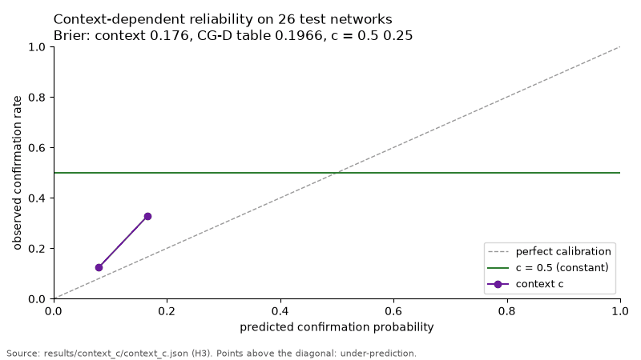

A logistic model of each neighbour's confirmation probability from reference SNR, distance, station noise and the site's
history replaces the constant c. Fitted on the IU.MAKZ development period and six batch-A networks, tested on 26 batch-B
networks: 61 dismissed reviewed-associated alarms (P3 68, c = 0.5 81); Brier score 0.176 against 0.25 for c = 0.5. The
reliability curve shows under-prediction, so the gain is in resolution, not calibration; Platt and isotonic recalibration
keep the direction (66 and 75).

<a id="07"></a>
### 7. Regions (post hoc)

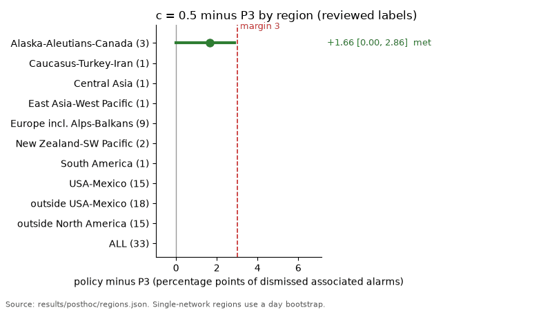

c = 0.5 minus P3 within each selection region. The margin is met in every region except the single East Asia network
(3.67 [1.08, 6.64]); outside USA–Mexico 0.77 [0.04, 1.54]. Single-network regions use a day bootstrap.

<a id="08"></a>
### 8. Analyst workload (post hoc)

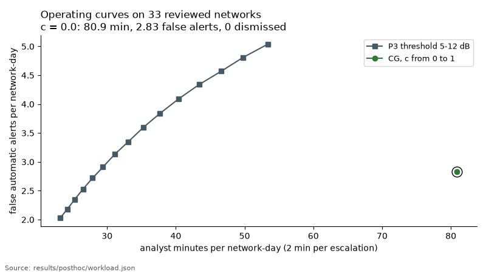

Operating curves at 2 analyst-minutes per escalation. At equal analyst time (37.7 min per network-day) c = 0.5 raised 1.82
automatic alerts without a reviewed event per network-day against 3.84 for P3.

<a id="09"></a>
### 9. Gap map: overlap, chance, leave-one-out (post hoc)

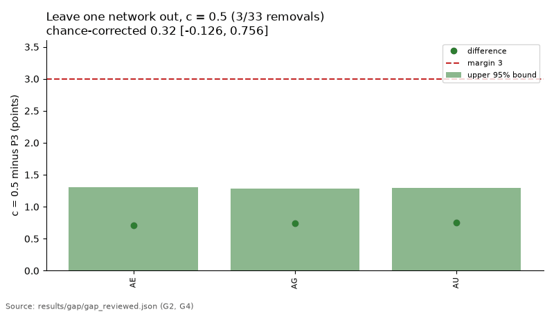

Jaccard overlap of the reviewed alarms dismissed by c = 0.5 and P3 is 0.81; the 34 alarms only c = 0.5 dismisses all had
every neighbour NO; the chance-corrected difference is 0.32 [−0.13, 0.76]; removing any single network changes no verdict.

<a id="10"></a>
### 10. Weights and thresholds sensitivity, ablations (post hoc)

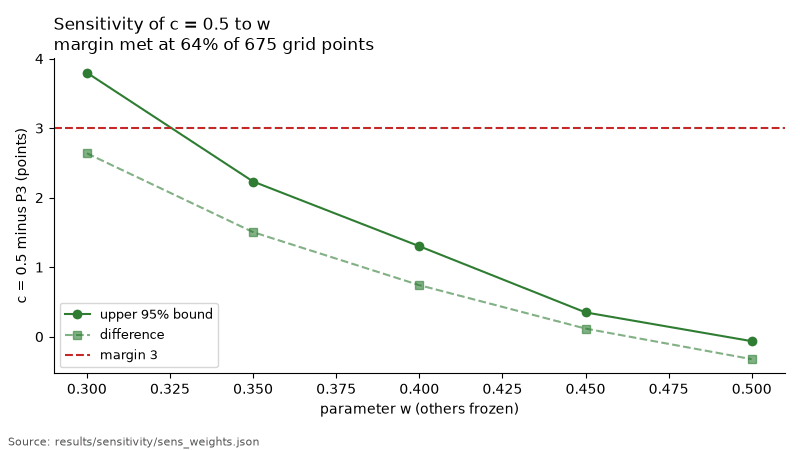

Each weight and threshold varied with the others frozen, then a 675-point grid. c = 0.5 met the margin at 64% of points,
CG-D at 53%, CG at 31%: the verdict depends on the settings. A single SNR threshold of 0.38 more than doubles the CG
dismissals (789 against 319).

<a id="11"></a>
### 11. Two-threshold baseline and alert cost (post hoc)

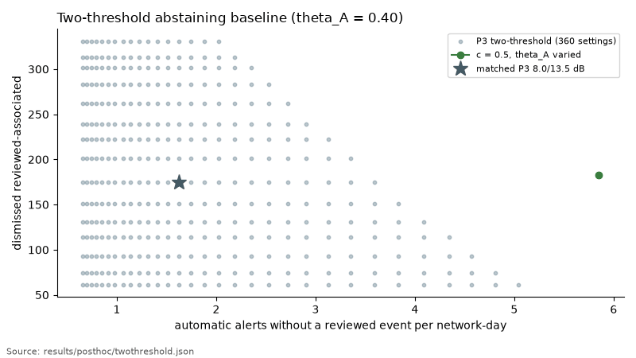

A P3 with two SNR thresholds (360 settings) against c = 0.5 with θ_A varied. The best matched setting (8.0 / 13.5 dB)
dismissed 175 against 183 and raised 1.62 false alerts against 1.82 per network-day, with more escalations; no setting is
better on all three counts.

<a id="12"></a>
### 12. Detection-probability likelihood baseline (post hoc)

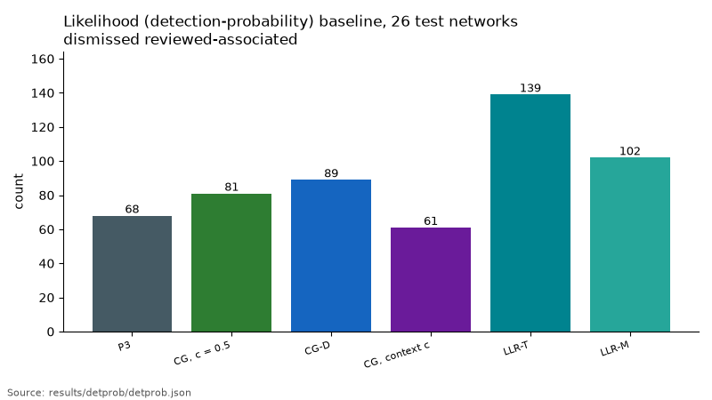

A likelihood-ratio rule on per-neighbour detection probability on the 26 test networks. LLR-M dismissed 102
reviewed-associated alarms and LLR-T 139, against 81 for c = 0.5 and 68 for P3; LLR-M fails the ratio criterion.

<a id="13"></a>
### 13. Forward re-tuning, low-chance subset, G.WUS (post hoc)

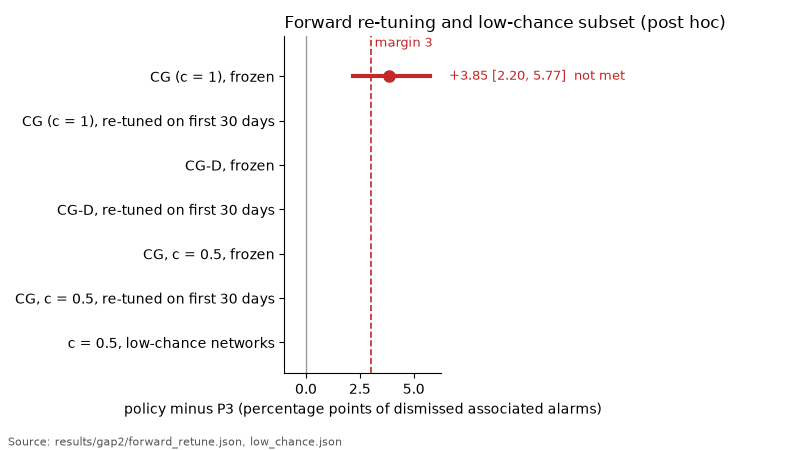

Thresholds re-tuned on the first 30 days of each network and applied to the later days. Frozen CG fails on those days
(3.85); re-tuned CG, CG-D and c = 0.5 meet both criteria (0.08, 0.11, 0.06). On networks with low chance association
c = 0.5 gives 0.58 [0.16, 1.05].

<a id="14"></a>
### 14. Learned baselines with a reject band (post hoc)

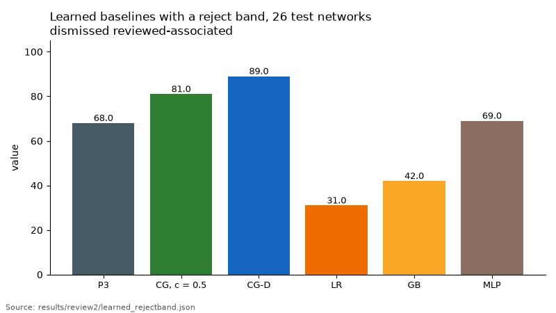

Logistic regression, gradient boosting and an MLP on the same features, each with a reject band tuned like the rule. They
dismiss fewer reviewed events (LR 31, GB 42, MLP 69, against 81) but escalate more and raise more false alerts.

<a id="15"></a>
### 15. Calendar bootstrap; Holm at 20,000 resamples (post hoc)

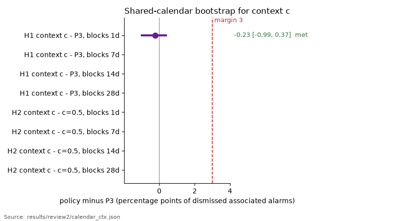

Context-c hypotheses re-tested with a bootstrap over shared calendar blocks of 1, 7, 14 and 28 days; H1 and H2 hold at every
length. With 20,000 resamples over 113 tests, Holm keeps c = 0.5, CG-D and both context-c tests and drops CG (p 1.0).

<a id="16"></a>
### 16. Margin from analyst cost (post hoc)

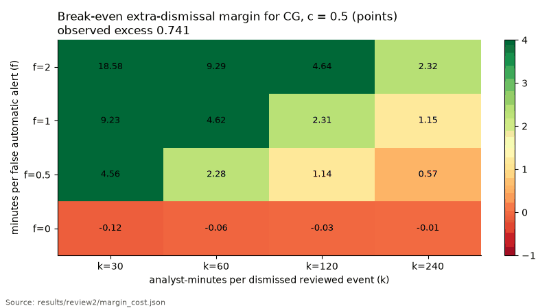

The extra dismissals of c = 0.5 (0.74 points) and CG-D (0.97) against the false alerts they avoid, for f minutes per false
alert and k minutes per dismissed reviewed event. With f ≥ 0.5 and k ≤ 120 the break-even margin exceeds the observed
excess; when false alerts cost nothing it does not.

<a id="17"></a>
### 17. Undefined SNR; threshold-table check (post hoc)

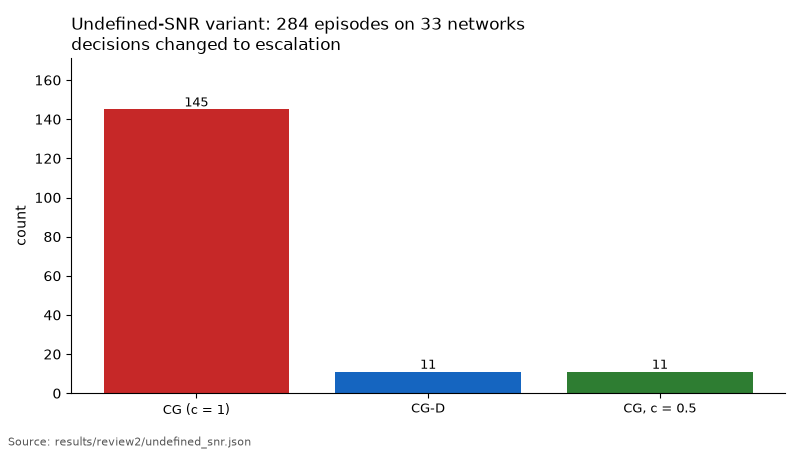

Episodes with undefined reference SNR (284) escalated instead of scored: no verdict changes. The closed-form SNR threshold
table: 81 cells checked, 0 mismatches, and the frozen decisions of 263,019 episodes reproduced.

<a id="18"></a>
### 18. Magnitude–distance detection probability (post hoc)

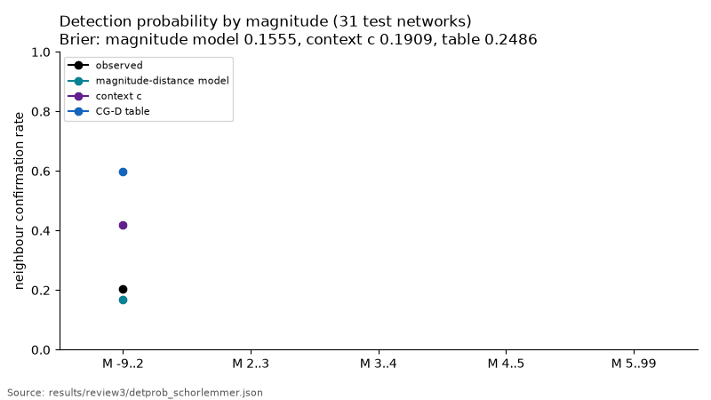

A magnitude–distance detection-probability model in the style of Schorlemmer and Woessner compared with context c on 31
networks: Brier 0.156, context c 0.191, CG-D table 0.249, constant 0.25.

<a id="19"></a>
### 19. Cost-optimal thresholds (post hoc)

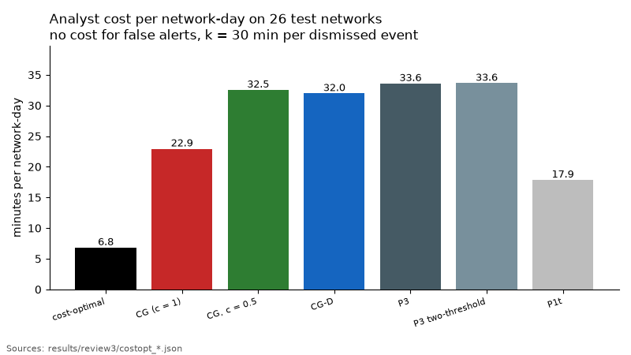

Thresholds chosen to minimise analyst cost on development data, applied to 26 test networks. The frozen thresholds cost far
more than the optimum (c = 0.5 33.1 against 9.0 min per network-day at k = 60). With a false-alert cost of 15 min, c = 0.5
(54.7) and CG-D (52.1) cost less than P3 (86.2) and P1t (269.0); these frames are exploratory.

<a id="20"></a>
### 20. Learned false-event screen (post hoc)

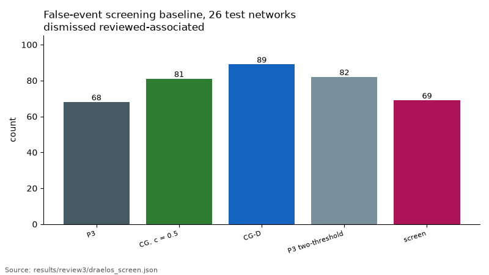

A learned false-event screen in the style of Draelos et al. matches P3 on dismissals (69 against 68) but escalates more and
raises 14,885 false automatic alerts against 6,842 for c = 0.5.

<a id="21"></a>
### 21. Kazakhstan, analyst-reviewed labels

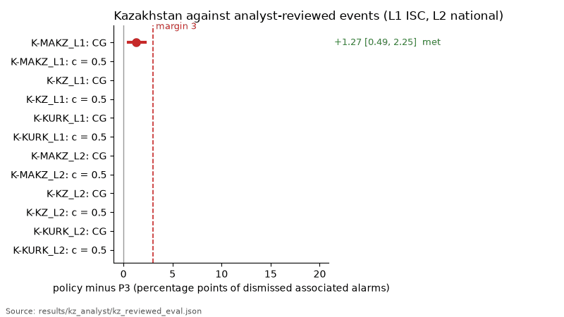

The Kazakhstan tests rescored against ISC Reviewed (L1) and the national bulletin (L2). At IU.MAKZ every variant met the
margin on L1 (CG 1.27, c = 0.5 0.64); on the KZ network CG did not (3.10) and c = 0.5 did (0.91); at KURK on L2 c = 0.5 did
not (3.10 [1.34, 5.08]).

<a id="22"></a>
### 22. Blind adjudication package (prepared, not done)

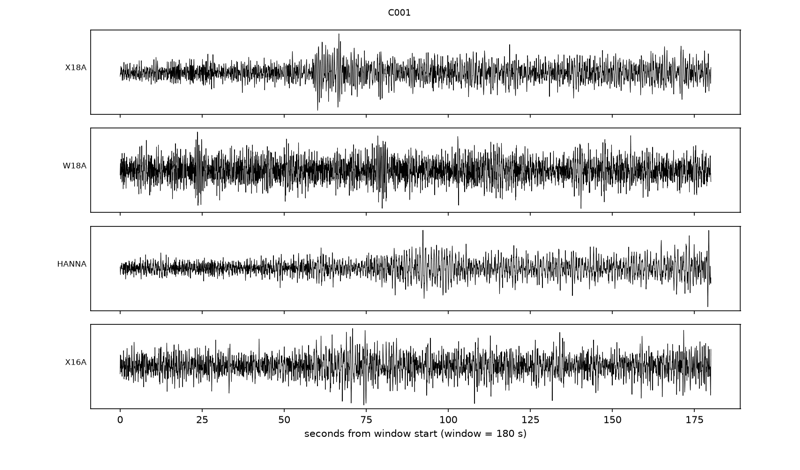

Waveform plots of 102 disputed alarms, without any rule label, prepared for a blind analyst. The adjudication has not been
done; no result is claimed.

<a id="23"></a>
### 23. Evidence-sufficiency stress test (post hoc)

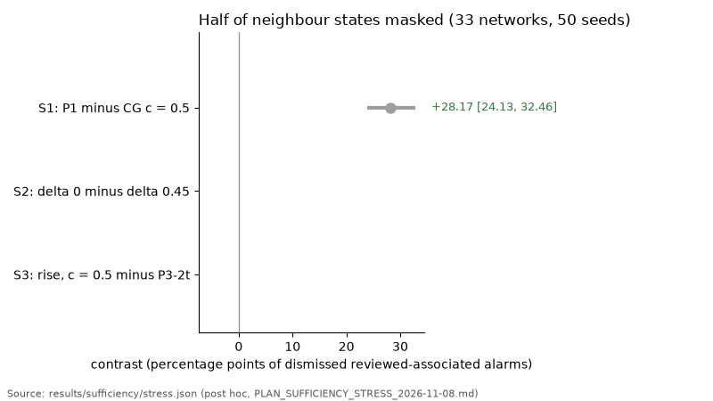

Neighbour-site states of the 33 reviewed-label networks (263,303 episodes, 4,321 reviewed-associated) set to MISSING at
random, per episode and site or as whole-day site outages, with 50 masking seeds and 500 cluster-bootstrap draws each. At
p = 0.5 classic coincidence dismissed 28.17 points [24.13, 32.46] more reviewed-associated alarms than CG with c = 0.5 (S1);
removing the sufficiency threshold (δ = 0 against 0.45) added 0.37 points [0.08, 0.88] of dismissals (S2); the rise in
dismissals from p = 0 to 0.5 was 3.78 points [2.32, 5.47] smaller for c = 0.5 than for the two-threshold abstaining rule
(S3). All three held under correlated masking. On the 3,062 real episodes with at least two neighbour sites missing,
classic coincidence dismissed 9 of 35 reviewed-associated alarms and every criteria-governed variant 0.

<a id="24"></a>
### 24. Alaska analyst ground truth (confirmed and deleted events)

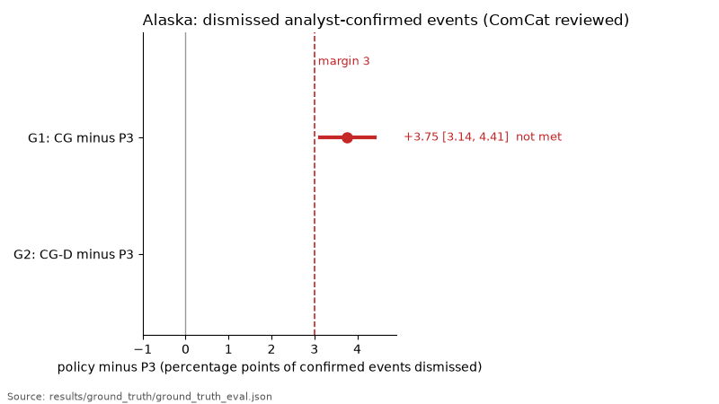

The Alaska run scored against USGS ComCat events that analysts confirmed (3,943 in 17,126 episodes) or deleted (114). CG
with c = 1 dismissed 3.75 points [3.14, 4.41] more confirmed events than P3 (G1 not met); CG-D stayed within the margin
(0.28 [0.10, 0.46], G2). CG raised 9.65% of deleted events as automatic alerts against 67.54% for P3 and 98.25% for P1t (G3),
and dismissed deleted events more often than confirmed ones (G4).

<a id="25"></a>
### 25. ML and LLM baselines, latency

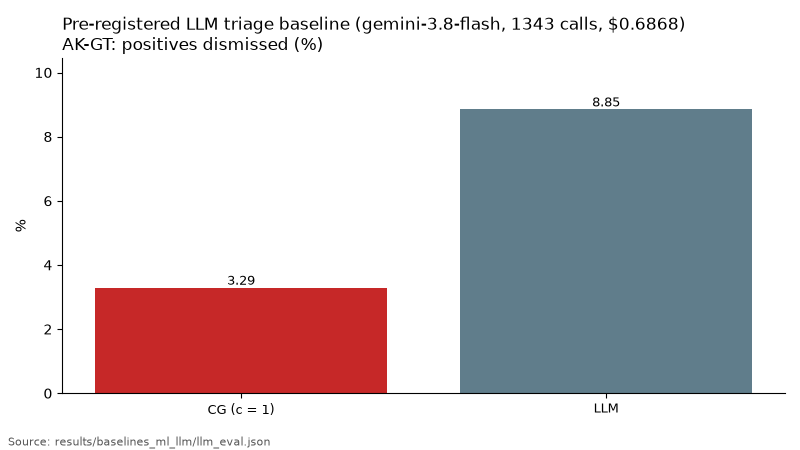

Logistic regression, gradient boosting and an MLP trained on the per-episode facts that CG uses, and a language-model
triage baseline (gemini-3.8-flash on Vertex AI, 1,343 calls, USD 0.69). On the Alaska sample the language model dismissed
8.85% of confirmed events against 3.29% for CG and alerted 65.79% of deleted events against 9.65%. CG decides one episode in
a median 1.1 µs on one CPU thread.

<a id="26"></a>
### 26. Explosion-associated alarms

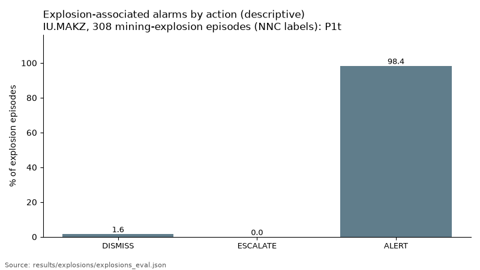

ComCat explosion labels gave 9 explosion episodes in the Alaska run, below the 20 required, so tests X1–X4 were not
exercised. Descriptively, at IU.MAKZ with national (NNC) labels, CG dismissed 1.62% of 308 mining-explosion episodes,
escalated 69.16% and alerted 29.22%; P1t alerted 98.38%.

<a id="27"></a>
### 27. Training-chosen two-threshold rule, δ sweep (post hoc)

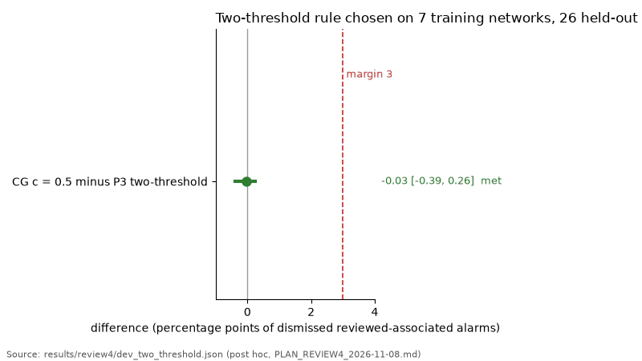

A two-threshold abstaining rule chosen on seven training networks (8.0 / 13.5 dB) and applied to the 26 held-out networks
dismissed 82 reviewed-associated alarms against 81 for c = 0.5 (−0.03 points [−0.39, 0.26]); c = 0.5 forwarded 1.45
automatic alerts without a reviewed event per network-day against 1.20 and escalated 15.06 against 15.77.

<a id="28"></a>
### 28. Time-disjoint test, June–August 2023 (registered, not run)

The frozen rules on the 33 reviewed networks in June–August 2023, a period no artefact of this repository touched
([disjoint_check.json](results/tdh2023/disjoint_check.json)). The plan was pushed before any 2023 data; no result yet.

## Policies compared

| Policy | Rule |
|---|---|
| P1 classic coincidence | ALERT if any neighbour site is YES, otherwise DISMISS (MISSING counts as NO) |
| P1t tuned coincidence | ALERT if any neighbour is YES or SNR ≥ 8.0 dB, otherwise DISMISS |
| P3 abstaining, availability-blind | ALERT if any YES and SNR ≥ 7.5 dB; DISMISS if no YES and SNR < 7.5 dB; otherwise ESCALATE |
| P2 abstaining, availability-aware | as P3 at 10.5 dB, but DISMISS also requires at least one NO |
| CG | the model above, c = 1 |
| CG-D | c from the development confirmation tables |
| CG c = 0.5 | one constant c = 0.5 for every valid NO |

## Data

| Station | Role | Distance to IU.MAKZ |
|---|---|---|
| IU.MAKZ 00.BHZ | reference (Makanchi, Kazakhstan) | — |
| IM.MK31 BHZ | element of the Makanchi array | 24.0 km |
| II.KURK 00.BHZ | Kurchatov, Kazakhstan | 499.6 km |
| G.WUS 00.BHZ | Wushi, Xinjiang, China | 661.1 km |
| KZ.MAKZ / KZ.MKAR / KZ.KURK / KZ.PDGK | second network, same area | — / 23.9 / 499.6 / 433.6 km |
| AK.CUT / AK.L22K / AK.COLD / AK.E22K | Alaska | — / 29.4 / 537.6 / 642.7 km (to AK.CUT) |

StationXML of every channel used is in [results/metadata/](results/metadata/). The KZ streams may share physical
instruments with IM.MK31 and II.KURK ([station_comparison.json](results/metadata/station_comparison.json)), so the KZ test
is a dependent replication.

The multi-network test chose networks from FDSN station metadata by a rule pushed before any waveform was requested
([SELECTION_RULE_V2_2026-11-08.md](SELECTION_RULE_V2_2026-11-08.md)); neighbours within 50 km form one site; every other
parameter is frozen. Period 8 January – 7 July 2024. 38 networks entered the pooled catalogue-label analysis and 33 the
reviewed-label analysis; the reason for each exclusion is in [FLEET_DEVIATIONS.md](results/v2/FLEET_DEVIATIONS.md) and the
per-network table in [NETWORK_CHECK.md](results/v2/NETWORK_CHECK.md).

| Selection region | Networks (pooled) |
|---|---|
| Central Asia | KR, QZ |
| Europe incl. Alps–Balkans | BW, EE, FN, HE, HL, IV, NS, PL, SI |
| USA–Mexico | AE, AG, C0, CN, CO, ET, IW, MB, N4, NE, NM, OH, OK, PE, TX, UO, UU, UW, WW |
| Alaska–Aleutians–Canada | AV, NY, RV |
| New Zealand–SW Pacific | AU, ND |
| East Asia–West Pacific | JP |
| South America | C1 |
| Caucasus–Turkey–Iran | HC |

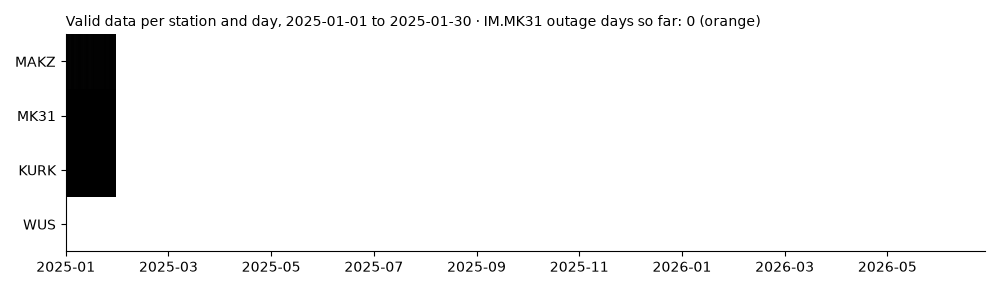

*Daily share of valid data per station over the extended test at IU.MAKZ; the 24 IM.MK31 outage days are orange.*

## Reproducing the results

Python 3.12. The scoring scripts read only files in `results/`; they do not download data.

```bash
git clone https://github.com/Syrym-Zhakypbekov/sparse-seismic-criteria-governed-triage
cd sparse-seismic-criteria-governed-triage
python -m venv .venv && . .venv/bin/activate        # Windows: .venv\Scripts\activate
pip install -r requirements.txt
```

Each command rewrites one result file; compare it with the committed version (`git diff results/`).

```bash
python analysis/cg_evaluation.py           # Tables 4-5 (development period)
python analysis/heldout_table6.py          # Section 4.3 (held-out period)
python analysis/extended_eval.py           # Table 6, E1-E4
python analysis/kurk_extended.py           # Table 7, K1-K4
python analysis/cgd_2024.py                # Table 8, D1-D4
python analysis/discount_sweep.py          # Table 9 (post hoc)
python analysis/posthoc_extended.py        # Table 10 (post hoc)
python analysis/kz_network.py              # Table 11, N1-N5
python analysis/ak_network.py              # Table 12, R1-R6
python analysis/v2_networks.py AB          # Table 14 (also A, B, EXT, AEXT)
python analysis/v2_report_tables.py        # Tables D1-D3
python analysis/context_c.py               # Table 21, Figure 4
python analysis/posthoc_regions.py         # Table 22, Figure 5 (post hoc)
python analysis/review2.py                 # robustness analyses (experiments 14-17)
python analysis/review3.py                 # experiments 18-20
python analysis/review4.py                 # experiment 27
python analysis/sufficiency_stress.py && python analysis/sufficiency_tables.py   # experiment 23
python analysis/figures.py                 # Figures 1-3
python analysis/make_readme_gifs.py        # animations in figures/gif/
```

Scripts that score against analyst-reviewed bulletins need the bulletin files first:

```bash
bash scripts/fetch_labels.sh               # ISC and USGS ComCat queries, a few hundred MB
python analysis/v2_reviewed_bulletin.py score
python analysis/ground_truth_v2.py score
python analysis/kz_reviewed_labels.py score
python analysis/v2_rescue_score.py score
python analysis/explosions_v2.py score
```

The SHA-256 of every label file used in the paper is stored next to its output (`results/*/labels/SHA256.txt`,
`results/*/labels/download_record.json`, `results/nnc/raw/manifest.json`). Bulletins are revised, so a new download may
differ from the stored hashes; the differences then show which events changed.

Re-running the pipeline (waveforms to episodes) is possible but slow. `pipeline/extended_stalta_criteria.py` requests
waveforms from FDSN services and events from ISC and USGS. Multi-network runs go through
`analysis/v2_fleet/run_network.py <NET>`, which reads the network configuration from `results/v2/`, tunes the detector on the
week before the evaluation period and runs the frozen pipeline through `pipeline/p10_v2_datacentre_wrapper.py`; the wrapper
refuses to run unless the pipeline's SHA-256 (LF line endings) is
`4c8c9a715bdfc94c7790ac0793f85360ae6a75489ca197acc2aad92483168284`. Each run folder keeps `run.log`, `summary.json` and a
`transfer.txt` with the SHA-256 of every output file.

The learned and language-model baselines (`analysis/baselines_ml_llm.py`) need scikit-learn; the language-model part calls a
Gemini model on Google Cloud Vertex AI and needs `GCP_PROJECT` and `gcloud` credentials. The responses used in the paper are
stored in `results/baselines_ml_llm/llm/calls.jsonl`, so the scoring step runs without a call. EQTransformer and PhaseNet runs
need SeisBench and PyTorch (`requirements-detectors.txt`, [DETECTOR_ENVIRONMENT.md](docs/DETECTOR_ENVIRONMENT.md)).

## Compute and notebooks

The pipeline ran on Google Cloud virtual machines, Kaggle notebooks, Google Colab and a laptop. The Kaggle notebooks are
public; each embeds the frozen pipeline file and runs it for one configuration.

| Kaggle notebook | What it computes | Output in this repository | Used in |
|---|---|---|---|
| [p10-seismic-stalta-criteria](https://www.kaggle.com/code/syrym95/p10-seismic-stalta-criteria) | IU.MAKZ development period, STA/LTA and neighbour states | `results/stage1_v3/` | Tables 4–5 |
| [p10-seismic-heldout](https://www.kaggle.com/code/syrym95/p10-seismic-heldout) | IU.MAKZ held-out period | `results/heldout/` | Section 4.3 |
| [p10-seismic-extended-2026h1](https://www.kaggle.com/code/syrym95/p10-seismic-extended-2026h1) | extended test, first half of 2026 | `results/extended/kaggle_2026h1/` | Table 6 |
| [p10-seismic-eqtransformer](https://www.kaggle.com/code/syrym95/p10-seismic-eqtransformer) | EQTransformer detector run | `results/eqt/` | detector comparison |
| [p10-seismic-phasenet-extended](https://www.kaggle.com/code/syrym95/p10-seismic-phasenet-extended) | PhaseNet detector on the extended episodes | `results/phasenet_extended/` | detector comparison |
| [p10-v2-ae](https://www.kaggle.com/code/syrym95/p10-v2-ae), [-ag](https://www.kaggle.com/code/syrym95/p10-v2-ag), [-co](https://www.kaggle.com/code/syrym95/p10-v2-co), [-cu](https://www.kaggle.com/code/syrym95/p10-v2-cu), [-et](https://www.kaggle.com/code/syrym95/p10-v2-et), [-mb](https://www.kaggle.com/code/syrym95/p10-v2-mb), [-n4](https://www.kaggle.com/code/syrym95/p10-v2-n4), [-ne](https://www.kaggle.com/code/syrym95/p10-v2-ne), [-uo](https://www.kaggle.com/code/syrym95/p10-v2-uo), [-ww](https://www.kaggle.com/code/syrym95/p10-v2-ww) | one multi-network run per network | `results/v2/runs*/` | Table 14, experiments 2–3 |
| [p10-v2-cn-r2](https://www.kaggle.com/code/syrym95/p10-v2-cn-r2), [-nm-r2](https://www.kaggle.com/code/syrym95/p10-v2-nm-r2), [-rv-r2](https://www.kaggle.com/code/syrym95/p10-v2-rv-r2), [-uu-r2](https://www.kaggle.com/code/syrym95/p10-v2-uu-r2) | retries of failed network runs | `results/v2/`, [FLEET_DEVIATIONS.md](results/v2/FLEET_DEVIATIONS.md) | experiments 2–3 |
| [p10-v2-ab-rescue](https://www.kaggle.com/code/syrym95/p10-v2-ab-rescue), [-aw-rescue](https://www.kaggle.com/code/syrym95/p10-v2-aw-rescue), [-cu-rescue](https://www.kaggle.com/code/syrym95/p10-v2-cu-rescue), [-cz-rescue](https://www.kaggle.com/code/syrym95/p10-v2-cz-rescue), [-fr-rescue](https://www.kaggle.com/code/syrym95/p10-v2-fr-rescue), [-sc-rescue](https://www.kaggle.com/code/syrym95/p10-v2-sc-rescue) | rescue runs of excluded networks | `results/v2_rescue/` | experiment 5 |

Google Colab ran EQTransformer on GPU for the 18,637 extended episodes and two replicate network runs; the code that ran
there is [pipeline/eqt_extended_colab.py](pipeline/eqt_extended_colab.py). Runs repeated on different machines gave
identical decisions ([replicate_TX.json](results/v2/replicate_TX.json), [replicate_UU.json](results/v2/replicate_UU.json)).

| Record | Link |
|---|---|
| OSF registration of the test plans | https://osf.io/y8qxz (DOI [10.17605/OSF.IO/Y8QXZ](https://doi.org/10.17605/OSF.IO/Y8QXZ)) |
| OSF project | the working project behind the registration is private; the registration above is its public, frozen copy |
| Archived release of this repository (Zenodo) | https://zenodo.org/records/24053125 (DOI [10.5281/zenodo.24053125](https://doi.org/10.5281/zenodo.24053125); all versions [10.5281/zenodo.24053124](https://doi.org/10.5281/zenodo.24053124)) |
| Journal Special Issue | [Sensors, "Sensor-Based Seismic Network: Issues and Challenges"](https://www.mdpi.com/journal/sensors/special_issues/3uuc1584a0) |

## Pre-registration

Each pre-specified test has a plan file that was pushed to the development repository before the earliest output of the
test. The push times, read from the GitHub activity record of that repository, are in
[prespecification_timeline.json](results/provenance/prespecification_timeline.json). The reviewed-bulletin test and the
prospective test are also registered on OSF. Analyses added after a result are labelled post hoc here, in
[MANIFEST.md](MANIFEST.md) and in the paper. Deviations from a plan are logged next to the results
([FLEET_DEVIATIONS.md](results/v2/FLEET_DEVIATIONS.md), `results/*/DEVIATIONS.md`).

## Repository layout

| Path | Contents |
|---|---|
| `pipeline/` | waveform download, STA/LTA detection, episodes, neighbour states, catalogue association |
| `analysis/` | scoring of every table, multi-network and reviewed-bulletin scoring, post hoc analyses, figures, animations |
| `analysis/v2_fleet/` | per-network runner of the multi-network test (`run_network.py`, `run_rescue.py`) |
| `results/` | episode tables, run logs, evaluation JSON per test, post hoc outputs, StationXML, provenance |
| `figures/` | figures of the paper; `figures/gif/` one animation per experiment |
| `adjudication/blind_v1/` | blind waveform-adjudication package (prepared, not adjudicated) |
| `PREREGISTRATION_*.md`, `SELECTION_RULE_*.md`, `ANALYSIS_PLAN_NNC.md` | plans of the pre-specified tests |
| `PLAN_*.md` | plans of post hoc analyses, each pushed before the analysis was computed |
| `docs/` | detector environment, reference list |
| `MANIFEST.md` | every table, figure and section of the paper, its script and result file |
| `scripts/fetch_labels.sh` | re-downloads the bulletin label files that are not redistributed here |

## Data sources

| Source | Use | Reference |
|---|---|---|
| EarthScope FDSN dataselect and station services | waveforms, StationXML | https://service.earthscope.org/fdsnws/ |
| Other FDSN data centres of the multi-network test | waveforms, StationXML | [datacentres.json](results/v2/selection/datacentres.json) |
| ISC Bulletin and ISC Reviewed Bulletin (FDSN event) | catalogue association, reviewed labels | https://doi.org/10.31905/D808B830 |
| USGS ANSS ComCat (FDSN event) | catalogue association, reviewed and deleted events | https://doi.org/10.5066/F7MS3QZH |
| NNC/KNDC events via the ISC event service | regional labels, Kazakhstan | Appendix C of the paper |
| ObsPy 1.5.1, TauP iasp91 | processing, travel times | https://docs.obspy.org/ |
| SeisBench (EQTransformer, PhaseNet) | detector comparison | https://github.com/seisbench/seisbench |

Seismic networks of the single-network tests:

- IU: Albuquerque Seismological Laboratory/USGS (1988), Global Seismograph Network (GSN – IRIS/USGS). https://doi.org/10.7914/SN/IU
- II: Scripps Institution of Oceanography (1986), Global Seismograph Network – IRIS/IDA. https://doi.org/10.7914/SN/II
- G: Institut de physique du globe de Paris and EOST (1982), GEOSCOPE. https://doi.org/10.18715/GEOSCOPE.G
- IM: International Miscellaneous Stations, Makanchi array. https://www.fdsn.org/networks/detail/IM/
- KZ: Institute of Geophysical Research (KNDC) (1994), Kazakhstan Network. https://doi.org/10.7914/SN/KZ
- AK: Alaska Earthquake Center, University of Alaska Fairbanks (1987), Alaska Geophysical Network. https://doi.org/10.7914/SN/AK

The networks of the multi-network test are listed in [NETWORK_CHECK.md](results/v2/NETWORK_CHECK.md); each is described at
https://www.fdsn.org/networks/. Waveform data are not redistributed here and remain under the terms of their networks.

## Known limitations

- The primary hypothesis (c = 1) failed on reviewed events, in Kazakhstan (E3, K3, N3) and on Alaska confirmed events (G1).
- The margin verdict depends on hand-set weights and thresholds (experiment 10), and the rule is close to a two-threshold
  abstaining rule (experiments 11 and 27).
- Labels associate alarms with bulletin events by time; they are not waveform adjudications. The blind adjudication is
  prepared but not done; the answer key is not here.
- The single East Asia network (JP) and the rescued networks taken alone do not meet the criteria.
- One detector (STA/LTA) drives the decisions; the 3-point margin and the 1.5 ratio bound were fixed in each plan, not
  derived from analyst cost.
- Raw waveforms are not included. Episode tables, availability tables and catalogue extracts produced by the pipeline are.
- Bulletin label files (ISC, USGS ComCat, teleseismic queries and the raw NNC QuakeML) are not included;
  `scripts/fetch_labels.sh` re-downloads them, and the stored hashes allow a comparison.
- Plan files (`PREREGISTRATION_*`, `PLAN_*`, `SELECTION_RULE_*`, `ANALYSIS_PLAN_NNC.md`) and `pipeline/` are byte-for-byte
  copies of the registered versions. Their commit references point to the development repository, which is not public;
  the push times of those commits are kept in `results/provenance/`. `analysis/r16_checks.py` reads the activity record of
  that repository and cannot be re-run against this one.
- Figure 4 is a copy of `results/context_c/calibration_T1.png` written by `analysis/context_c.py`.
- Orchestration scripts for the cloud machines are not included; the per-network runner and the run logs are. Raw run logs
  are kept verbatim and contain machine paths.
- The time-disjoint test of June–August 2023 is registered but has no result.

## Licence

Code: MIT ([LICENSE](LICENSE)). Results, tables and figures in `results/` and `figures/`: CC BY 4.0
([LICENSE-results.md](LICENSE-results.md)). Waveform data remain under the terms of their networks.

## Citation

See [CITATION.cff](CITATION.cff). Until the paper is published, please cite this archive (Zenodo concept DOI 10.5281/zenodo.24053124).

Related work by the authors: Zhakypbekov, S.; Bykov, A.; Yermakova, V.; Zhuginissova, A.; Vasquez, M.A. A Criteria-Governed
Human-in-the-Loop Information System Architecture for Explainable AI-Assisted Learning and Preliminary Assessment.
*Informatics* **2026**, 13, 179. https://doi.org/10.3390/informatics13110179
